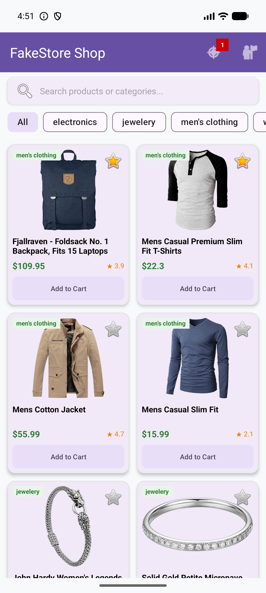
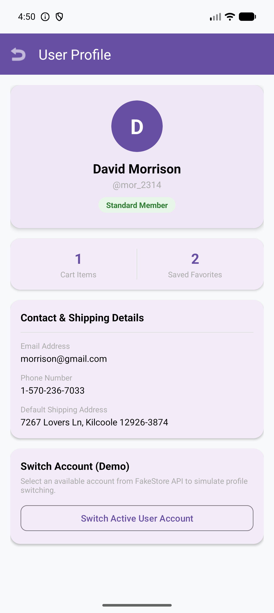

# Android Workshop - FakeStore E-Commerce App 🛍️

A modern, responsive Android application built using **Kotlin**, **MVVM Architecture**, **Coroutines & Flow**, **Retrofit**, and **Material Design 3**.

The application connects to the [FakeStore API](https://fakestoreapi.com/) to offer a full e-commerce shopping experience complete with product listing, category filtering, search, product detail view, wishlist/favorites management, active shopping cart with live calculations, and user profile management.

---

## 📱 App Screenshots

| Main Storefront | User Profile |
| :---: | :---: |
|  |  |

| Product Details | Shopping Cart |
| :---: | :---: |
|  |  |

---

## ✨ Features

- 🛒 **Storefront & Product Catalog**: Browse products in a responsive grid view with image loading via Coil.
- 🔍 **Real-time Search & Filtering**: Dynamically search products by title or filter by categories using Material chips.
- ⭐ **Favorites / Wishlist**: Toggle favorites directly from product items or detail views.
- 🛍️ **Interactive Shopping Cart**: Add items, adjust quantities, view live subtotal, estimated taxes (5%), and total calculations.
- 👤 **User Profile Section**:
  - Displays user account info (Name, Avatar Initials, Username, Email, Phone, Shipping Address).
  - Shows active membership status badge (*VIP Gold Member*, *Premium Shopper*, etc.).
  - Tracks live stats for Cart items and Saved Favorites.
  - Demo switcher to easily switch active accounts loaded from FakeStore API.

---

## 🛠️ Tech Stack & Architecture

- **Language**: Kotlin 1.9+
- **Architecture**: MVVM (Model-View-ViewModel) pattern
- **Network**: Retrofit 2 + Gson Converter
- **Image Loading**: Coil
- **UI Toolkit**: Android Views, ViewBinding, Material Design 3, ConstraintLayout
- **Asynchronous Flow**: Kotlin Coroutines & `StateFlow` / `SharedFlow`
- **Local Persistence**: SharedPreferences (for cart state and active user selection)

---

## 🚀 Getting Started

1. **Clone the Repository**:
   ```bash
   git clone https://github.com/Ishaarajput/Android_Workshop.git
   cd Android_Workshop
   ```

2. **Open in Android Studio**:
   - Open Android Studio (Ladybug / Jellyfish or later).
   - Select **Open an existing project** and choose the cloned repository folder.

3. **Build & Run**:
   - Let Gradle sync completely.
   - Select an Android Emulator (API 26+) or connected physical device.
   - Click **Run (`Shift + F10`)**.

---

## 📄 License
This project is open-source and available under the [MIT License](LICENSE).
